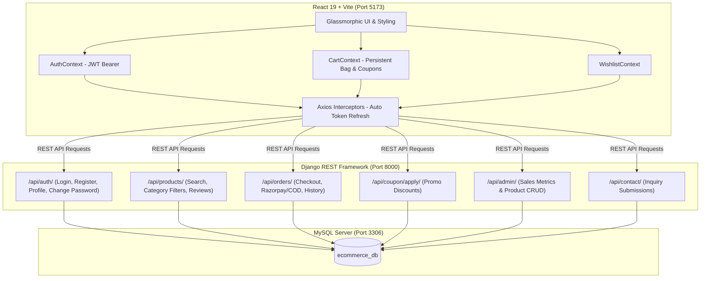

# 🛍️ Aura Store - Fullstack E-Commerce Portal

A production-grade, secure, and modern E-Commerce Shopping Application built using **React 19 (Frontend)**, **Django REST Framework (Backend)**, and **MySQL (Database)** with **SimpleJWT Authentication**.

---

## 🌟 Highlights & Key Features

- **⚡ Modern Glassmorphic Frontend**: Responsive, sleek dark-mode UI with smooth micro-animations built using React 19, Vite, and Lucide Icons.
- **🔐 JWT Authentication with Auto Refresh**: Secure Access & Refresh token rotation with Axios interceptors.
- **🐬 MySQL Relational Database**: 19 normalized relational tables connected via PyMySQL.
- **📦 25+ Pre-Seeded Products**: Diverse catalog across 7 categories with real high-resolution images, ratings, and customer reviews.
- **🛒 Dynamic Shopping Bag & Checkout**: Slide-out cart drawer with live promo code discount calculations (`WELCOME20`, `MEGA50`, `SUPERTECH30`, `FESTIVE10`).
- **❤️ Saved Wishlist & Move to Bag**: 1-click favoriting and instant transfer to checkout.
- **📊 Merchant Admin Dashboard**: Real-time sales analytics, revenue metrics, order table, and an interactive **"+ Add Product"** modal.
- **👤 User Profile & Security**: Update profile details and change passwords securely.
- **💬 Customer Care & Support**: 24/7 inquiry ticket submission interface.

---

## 🏗️ Architecture



---

## 🚀 Quick Start & Running Locally

### Option 1: One-Click Startup — Double-click `start_all.bat` (Windows)
Double-click [`start_all.bat`](start_all.bat) in the project root.  
It will: run migrations → build React → start server → open browser at **http://127.0.0.1:8000/**

### Option 2: PowerShell Script
Right-click [`start_server.ps1`](start_server.ps1) → **Run with PowerShell**, or from the project folder:
```powershell
.\start_server.ps1
```

### Option 3: Manual Commands (PowerShell)

> ⚠️ **Important:** Always use `.\venv\Scripts\python.exe manage.py ...`  
> Do NOT type `manage.py` alone — PowerShell cannot run it directly.

```powershell
# In the project root folder:
.\venv\Scripts\python.exe manage.py migrate
.\venv\Scripts\python.exe seed_data.py

# Build React frontend
cd frontend
npm install
npm run build
cd ..

# Start the unified server
.\venv\Scripts\python.exe manage.py runserver 127.0.0.1:8000
```

All pages are served from **one single link**: http://127.0.0.1:8000/

| Page | URL |
|:-----|:----|
| Store Home | http://127.0.0.1:8000/ |
| Explore Shop | http://127.0.0.1:8000/shop |
| Cart / Checkout | http://127.0.0.1:8000/checkout |
| Wishlist | http://127.0.0.1:8000/wishlist |
| My Orders | http://127.0.0.1:8000/orders |
| Merchant Dashboard | http://127.0.0.1:8000/admin |
| Django Admin Panel | http://127.0.0.1:8000/django-admin/ |
| REST API | http://127.0.0.1:8000/api/ |

---

## 🔑 Default Credentials & Test Data

### User Accounts:
| Role | Username | Password | Features |
| :--- | :--- | :--- | :--- |
| **Admin / Store Manager** | `admin` | `admin123` | Full Merchant Dashboard (`/admin`) & Django Admin |
| **Customer** | `johndoe` | `password123` | Wishlist, Order History, Reviews, and Profile Settings |

### Active Discount Coupons:
- **`WELCOME20`** → 20% OFF
- **`MEGA50`** → 50% OFF
- **`SUPERTECH30`** → 30% OFF
- **`FESTIVE10`** → 10% OFF

---

## 🌐 Key REST API Endpoints

| Method | Endpoint | Description |
| :--- | :--- | :--- |
| `POST` | `/api/auth/login/` | Obtain JWT Access & Refresh tokens |
| `POST` | `/api/auth/token/refresh/` | Refresh expired access token |
| `POST` | `/api/auth/register/` | Register new customer account |
| `GET/PUT` | `/api/auth/profile/` | View and update customer profile |
| `POST` | `/api/auth/change-password/` | Change customer password |
| `GET` | `/api/categories/` | List all product categories |
| `GET` | `/api/products/` | Filter products (`?category=`, `?search=`, `?sort=`, `?page=`) |
| `GET` | `/api/products/<id>/` | Product details with reviews |
| `POST` | `/api/products/<id>/reviews/create/` | Post a customer review |
| `GET/POST`| `/api/wishlist/` | List or add wishlist items |
| `POST` | `/api/wishlist/toggle/<id>/` | Toggle wishlist state |
| `POST` | `/api/coupon/apply/` | Validate discount coupon code |
| `POST` | `/api/orders/create/` | Place a new order |
| `GET` | `/api/orders/my-orders/` | List logged-in user's past orders |
| `GET` | `/api/admin/stats/` | Store revenue and overview stats (Admin only) |
| `POST` | `/api/admin/products/create/` | Add a new product (Admin only) |
| `DELETE` | `/api/admin/products/<id>/` | Delete product (Admin only) |
| `POST` | `/api/contact/` | Submit customer support inquiry |

---

## 🐬 MySQL Database Configuration

In `backend/settings.py`:
```python
DATABASES = {
    'default': {
        'ENGINE': 'django.db.backends.mysql',
        'NAME': os.environ.get('DB_NAME', 'ecommerce_db'),
        'USER': os.environ.get('DB_USER', 'root'),
        'PASSWORD': os.environ.get('DB_PASSWORD', 'root'),
        'HOST': os.environ.get('DB_HOST', '127.0.0.1'),
        'PORT': os.environ.get('DB_PORT', '3306'),
    }
}
```

---

## 💻 Tech Stack Summary

- **Frontend**: React 19, Vite, Lucide Icons, React Router v7, Axios with JWT interceptors.
- **Backend**: Python 3.9, Django 4.2 LTS, Django REST Framework, SimpleJWT, Django Filter, CORS Headers, PyMySQL.
- **Database**: MySQL 8.x / MariaDB.
